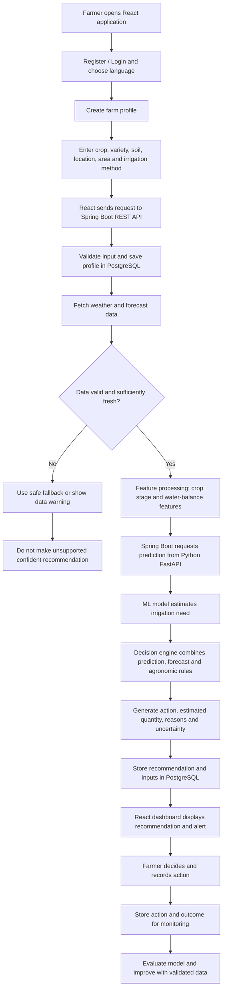

# JALRAKSHAK — Development Plan & Technical Blueprint

**Project:** JALRAKSHAK  
**Parent concept in source PPT:** KRISHISETU — AI-powered integrated platform for smarter and fairer farming  
**Module scope for this document:** Smart Irrigation Decision Support  
**Prepared:** 20 October 2026

---

## 1. JALRAKSHAK actually kya hai?

JALRAKSHAK ek **AI-assisted Smart Irrigation Decision Support System** hai. Iska objective farmer ko field-specific irrigation guidance dena hai—generic advice dene ke bajay crop, soil, location, farm area, irrigation method, crop growth stage, weather/forecast aur available soil-moisture information ko consider karna.

System farmer ko in sawalon ka jawab dene mein help karega:

- **When to irrigate?** Fasal ko paani kab dena chahiye?
- **How much water?** Kitna paani dena chahiye?
- **What action?** Irrigate, wait, ya partial irrigation suggest karna chahiye?
- **Why this recommendation?** System ne ye suggestion kin factors ke basis par diya?

JALRAKSHAK farmer ko information aur recommendation deta hai; final irrigation decision farmer ke paas rehta hai.

> **Important:** PPT system ka proposed design batati hai. Jab tak representative data, field testing aur model evaluation na ho, tab tak prediction accuracy, water savings ya crop outcomes ko proven result nahi maana jayega.

## 2. JALRAKSHAK kaise kaam karega?

1. **Onboard:** Farmer register karega, language choose karega aur farm profile banayega.
2. **Collect farm data:** Crop/variety, soil, location/area, irrigation method aur available history record hogi.
3. **Enrich with external data:** Weather/forecast liya jayega; soil-moisture sensor optional rahega.
4. **Validate and process:** Missing, invalid ya outlier values check hongi. Model ke liye crop stage aur water-balance jaise features derive kiye jayenge.
5. **Predict irrigation need:** Python ML service irrigation need estimate karegi.
6. **Make a decision:** Prediction ko forecast aur agronomic/risk rules ke saath combine karke `IRRIGATE`, `WAIT`, ya `PARTIAL IRRIGATION` suggestion, estimated water quantity aur explanation generate ki jayegi.
7. **Show recommendation:** React dashboard par recommendation, reasons aur alerts farmer-friendly language mein dikhenge.
8. **Record outcome:** Farmer ne kya action liya aur baad mein kya outcome hua, wo record hoga; ye monitoring aur future model improvement mein madad kar sakta hai.

**Illustrative example only:** Agar forecast mein effective rainfall expected ho aur available soil-moisture data immediate irrigation need support na karta ho, system `WAIT` suggest kar sakta hai. Real recommendation actual data aur validated agronomic logic par depend karegi.

## 3. Technology stack

PPT ke technical approach ke mutabik proposed stack:

| Layer | Technology | Responsibility |
|---|---|---|
| Frontend | React.js + JavaScript | Farmer dashboard, onboarding, farm profile, recommendations, alerts, history |
| Main backend | Java + Spring Boot + REST APIs | Business logic, validation, authentication, farm records, orchestration |
| Primary database recommendation | PostgreSQL | Structured farmer/farm records, irrigation decisions and history |
| Optional/additional database in PPT | MongoDB | PPT lists it but does not define a specific responsibility; add only if a clear need is identified |
| ML service | Python + FastAPI | Expose the irrigation prediction model through an API |
| ML libraries | Scikit-learn and/or XGBoost | Train and serve an evaluated prediction model, subject to suitable data |
| External data | Weather and forecast APIs | Weather conditions and forecast inputs |
| Optional hardware | Soil-moisture IoT sensor | Direct field moisture readings, if hardware and connectivity are available |
| Security | Spring Security + JWT | Authentication and authorization for protected APIs |

### Recommended architecture decision

Start with **PostgreSQL as the primary database**. The PPT mentions both PostgreSQL and MongoDB but does not describe why both are required. Avoid introducing MongoDB into the first version unless a specific data requirement justifies the extra operational complexity.

Use Spring Boot as the main application backend and FastAPI as a separate ML service. The React frontend should normally call Spring Boot; Spring Boot calls FastAPI for predictions. This keeps security and application rules in one main backend while allowing the model service to evolve independently.

## 4. End-to-end system flow

### Request/response boundary

- **React → Spring Boot:** profile data, dashboard requests, recommendation requests, feedback.
- **Spring Boot → PostgreSQL:** persistent structured records.
- **Spring Boot → Weather API:** current/forecast data, using configured credentials if required.
- **Spring Boot → FastAPI:** validated model features and model input.
- **FastAPI → Spring Boot:** prediction, model/version metadata and available uncertainty indicators.
- **Spring Boot → React:** farmer-friendly recommendation, reasons, data freshness and warnings.

## 5. Development phases and deliverables

### Phase 1 — Requirements and architecture

**Work**
- Confirm farmer journeys and the first supported crop/region.
- Define required and optional farm inputs.
- Define recommendation outputs and safe fallback behavior.
- Design API contracts, data model and module boundaries.

**Deliverables**
- Requirements and scope document.
- System architecture and Mermaid workflow.
- Initial database schema and API specification.
- Agreed MVP acceptance criteria.

### Phase 2 — Spring Boot backend and database

**Work**
- Create the Spring Boot project and configuration.
- Design farmer, farm, crop, irrigation recommendation and action-history entities.
- Implement validation, CRUD APIs, exception handling and initial authentication.
- Connect PostgreSQL and add migrations/seed data.

**Deliverables**
- Running backend.
- PostgreSQL schema and migration scripts.
- Documented and tested REST APIs.
- Basic API/security tests.

### Phase 3 — Weather and input-data pipeline

**Work**
- Select a suitable weather/forecast provider for the target region.
- Normalize units, timestamps and location.
- Handle missing, stale and implausible readings.
- Define optional sensor integration contract.

**Deliverables**
- Weather integration service.
- Validated, timestamped input data.
- Timeout/retry and fallback behavior.
- Data-quality tests and API error states.

### Phase 4 — Python ML service

**Work**
- Identify a suitable, representative dataset and target labels.
- Establish a simple baseline before trying more complex models.
- Prepare features such as crop, soil, growth stage and weather, as supported by the dataset.
- Train and evaluate Scikit-learn and/or XGBoost models.
- Expose inference via FastAPI with input/output validation.

**Deliverables**
- Dataset/source notes and data dictionary.
- Reproducible training/evaluation workflow.
- Baseline model and evaluation report.
- FastAPI prediction endpoint with tests and model version.
- Clear limitations and uncertainty handling.

**Dependency:** Do not claim a reliable trained model until the data and evaluation are adequate. If suitable labelled data is unavailable, implement a clearly labelled rules-based prototype while data collection/validation proceeds; do not fabricate model metrics.

### Phase 5 — Irrigation decision engine and service integration

**Work**
- Connect Spring Boot to FastAPI using a defined request/response contract.
- Combine ML output with forecast and validated agronomic rules.
- Define action states: `IRRIGATE`, `WAIT`, `PARTIAL_IRRIGATION`, and `INSUFFICIENT_DATA` when inputs are inadequate.
- Calculate water quantity only using documented, crop-appropriate logic.
- Store inputs, recommendation, reasons, timestamps and model version.

**Deliverables**
- Integrated recommendation API.
- Explainable recommendation response.
- Timeout, invalid-output and unavailable-model handling.
- End-to-end integration tests.

### Phase 6 — React farmer dashboard

**Work**
- Build registration/onboarding and farm-profile screens.
- Show current recommendation, reasons, input freshness and warnings.
- Add irrigation history, alerts and feedback/action capture.
- Add English by default and selected regional-language support.

**Deliverables**
- Responsive React UI.
- Backend-connected farmer workflow.
- Accessible, farmer-friendly recommendation cards.
- UI loading/error/empty states and basic usability tests.

### Phase 7 — Security, validation and pilot

**Work**
- Apply Spring Security + JWT and role-based access where required.
- Test API authorization, input validation and sensitive-data handling.
- Test stale weather, missing data, sensor failure and ML-service outage.
- Pilot on a limited crop/region with agronomic review and field feedback.
- Monitor model behavior and record limitations.

**Deliverables**
- Security and test report.
- Deployment/runbook and environment configuration guide.
- Pilot feedback report.
- Model and recommendation monitoring plan.
- Evidence-based list of known limitations and next improvements.

### Future scope — after the core MVP

- Soil-moisture IoT sensors.
- Satellite/remote-sensing-derived features where appropriate.
- Regional-language voice assistant.
- Crop disease/pest risk module.
- Expanded crop/region coverage.
- Integration with AGRIFAIR as part of the broader KRISHISETU platform.

## 6. Recommendations

1. **Keep the first release narrow:** choose a limited crop and geographic region instead of claiming support for all crops from day one.
2. **Build a vertical slice early:** complete one journey from farm profile → weather → recommendation → saved outcome before adding many features.
3. **Separate prediction from decision-making:** the ML model estimates need; a documented decision engine decides what action to suggest.
4. **Do not invent training data or accuracy:** document dataset provenance, splits, metrics and limitations.
5. **Keep recommendations explainable:** return reasons, data timestamps and warnings, not only a single score.
6. **Design safe fallbacks:** if inputs are missing, stale or contradictory, show `INSUFFICIENT_DATA` or a cautious warning rather than a confident irrigation quantity.
7. **Use PostgreSQL first:** introduce MongoDB only when a concrete use case warrants it.
8. **Keep IoT optional for MVP:** start with available weather and farm data; add sensors when hardware and field access are feasible.
9. **Secure all service boundaries:** validate inputs, protect credentials, add timeouts and avoid exposing the FastAPI service directly to public clients.
10. **Validate with domain experts:** irrigation quantities and crop-specific rules should be reviewed by qualified agronomy expertise before field use.
11. **Measure outcomes in a pilot:** evaluate model performance and real field outcomes; water savings and yield improvements remain targets until validated.
12. **Keep the farmer in control:** recommendations support decisions; they should not silently trigger irrigation hardware without a separately designed, tested and authorized control system.

## 7. Main technical issues and mitigation

| Technical issue | Why it matters | Mitigation |
|---|---|---|
| Missing or noisy soil/weather inputs | Can produce misleading recommendations | Validate ranges, track timestamps, show warnings, use conservative fallbacks |
| No representative labelled dataset | ML may not generalize to real farms | Start with baseline, document data gaps, collect/validate field data |
| Incorrect water-quantity estimate | May waste water or stress crops | Use crop-specific agronomic calculations and expert review |
| Weather API downtime or stale forecast | Decision may use outdated conditions | Timeouts, retries, cache freshness limits and explicit stale-data warnings |
| Java–Python integration failures | Recommendation flow can break | Versioned API contracts, schema validation, timeouts and integration tests |
| Sensor unavailable or unreliable | Direct soil-moisture signal may be missing | Make sensors optional, calibrate them, and handle missing readings explicitly |
| Connectivity constraints | Farmers may not load data reliably | Lightweight UI, cache suitable non-sensitive data and sync where practical |
| Unauthorized access or data exposure | Farm/profile data could be misused | Spring Security, JWT, authorization checks, secrets management and audit logs |
| Language and usability barriers | Farmers may misunderstand advice | Simple language, clear units, guided onboarding and user testing |
| Scaling to more crops/regions | Rules and model behavior may differ | Modular services, versioned models, region/crop validation and monitoring |

## 8. Suggested core data entities

This is a **recommended initial design**, not a schema explicitly specified in the PPT:

- `User` — identity, authentication reference and role.
- `Farm` — owner, location, area, soil type and irrigation method.
- `CropCycle` — crop/variety, planting date and growth-stage information.
- `WeatherObservation` — source, observation/forecast timestamp and relevant values.
- `SoilMoistureReading` — optional sensor/source, reading, timestamp and quality status.
- `IrrigationRecommendation` — suggested action, quantity if supportable, reasons, input snapshot, model version and timestamp.
- `FarmerAction` — action taken, time and optional feedback/outcome.

Use migrations and document units (for example, mm of water versus litres) to avoid ambiguous quantity fields. Exact fields should be finalized after requirements and agronomic rules are agreed.

## 9. MVP completion checklist

- [ ] Farmer can register/login and create a farm profile.
- [ ] Crop, soil, location, area and irrigation method are validated.
- [ ] Weather data is timestamped and its freshness is checked.
- [ ] Missing/invalid data results in a clear warning or `INSUFFICIENT_DATA`.
- [ ] Spring Boot can call the FastAPI prediction endpoint.
- [ ] Recommendation includes action, reasons, timestamp and model/version details.
- [ ] Water quantity is shown only when supported by documented logic.
- [ ] Recommendation and farmer action are stored.
- [ ] React UI handles loading, errors and low-connectivity cases gracefully.
- [ ] Security and integration tests pass.
- [ ] Pilot and model limitations are documented before impact claims are made.

---

## 10. Source and scope note

This blueprint is based primarily on the supplied **“KRISHISETU — AI-powered integrated platform for smarter & fairer farming”** PDF, especially its technical approach, feasibility, impact and future-scope pages. The source PPT lists React.js, Spring Boot + REST, PostgreSQL/MongoDB, Python with Scikit-learn/XGBoost, FastAPI, Spring Security + JWT, weather/market APIs and optional soil-moisture IoT.

The detailed phase sequence, initial entity list, fallback status, integration contracts and prioritization above are implementation recommendations for building the JALRAKSHAK module. They are not all explicitly prescribed by the PPT. AGRIFAIR marketplace features are outside the current module scope, except for future integration into KRISHISETU.
