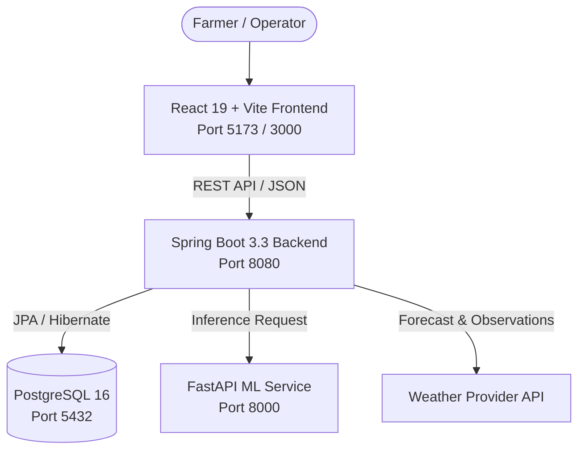

<!-- prettier-ignore -->
<div align="center">


# JALRAKSHAK

**Smart Irrigation Decision-Support Platform — Part of the KrishiSetu Initiative**


[Overview](#overview) • [Architecture](#architecture) • [Getting Started](#getting-started) • [API Reference](#api-reference) • [Configuration](#configuration) • [Troubleshooting](#troubleshooting)

</div>

JALRAKSHAK (*जलक्षक — Water Guardian*) is an AI-assisted smart irrigation decision-support platform designed for smallholder and commercial multi-crop farmers. It combines farm profiles, active crop cycles, soil-moisture readings, and weather observations to deliver explainable field-level irrigation recommendations (`IRRIGATE`, `PARTIAL_IRRIGATION`, `WAIT`, or `INSUFFICIENT_DATA`) while keeping final decision authority with the farmer.

> [!TIP]
> You can run the entire stack locally using Docker Compose or directly on your host machine with PostgreSQL, Java 21, Python 3.13, and Node.js 20+.

## Overview

Unlike black-box irrigation controllers or generic weather dashboards, JALRAKSHAK separates machine-learning inference from an explainable agronomic decision layer. Every recommendation records its input snapshot, confidence score, model version, and human-readable reasoning—falling back conservatively to `INSUFFICIENT_DATA` whenever weather or soil telemetry is missing or stale.

### Key Features

- **Explainable Irrigation Recommendations**: Generates actionable guidance (`IRRIGATE`, `PARTIAL_IRRIGATION`, `WAIT`, `INSUFFICIENT_DATA`) with water depth in millimeters (`mm`), confidence scores, and transparent reasoning.
- **Multi-Crop & Field Management**: Track multiple farms, soil types, irrigation methods, and active crop cycles across growth stages (`GERMINATION`, `VEGETATIVE`, `FLOWERING`, `GRAIN_FILL`, `MATURITY`).
- **Weather & Sensor Telemetry**: Record and query farm-specific weather observations and soil-moisture readings with freshness validation.
- **Closed-Loop Farmer Feedback**: Log executed irrigation actions and field feedback against historical recommendations for auditing and model evaluation.
- **Role-Based Security & JWT Auth**: Stateless JWT authentication with token revocation, password recovery, email verification, and strict farm-ownership validation.
- **Live Health & Readiness Probes**: Built-in liveness and readiness endpoints monitoring PostgreSQL and ML inference connectivity.

## Architecture



The system is organized as a multi-service monorepo:

| Directory | Service | Technology | Default Port |
| :--- | :--- | :--- | :--- |
| [`frontend/`](./frontend) | Web Application | React 19, Vite 8, Vitest, Oxlint | `5173` (dev) / `3000` (Docker) |
| [`backend/`](./backend) | Core REST API | Java 21, Spring Boot 3.3, Spring Security, JPA | `8080` |
| [`ml-service/`](./ml-service) | Inference Service | Python 3.13, FastAPI, Pydantic v2, Uvicorn | `8000` |
| [`docs/`](./docs) | System Specifications | Architecture, Data Model, and API Specs | — |

## Getting Started

### Prerequisites

- **Java (JDK)**: 21 LTS
- **Node.js**: 20+ LTS (with `npm` 10+)
- **Python**: 3.13
- **PostgreSQL**: 16+
- **Docker & Docker Compose**: Optional, for containerized execution

### Option 1: Run with Docker Compose

1. Create your root environment configuration:
   ```bash
   cp .env.example .env
   ```
2. Build and start all services:
   ```bash
   docker compose up --build
   ```
3. Access the services:
   - **Frontend**: `http://localhost:3000`
   - **Backend API**: `http://localhost:8080/api/health`
   - **ML Service**: `http://localhost:8000/health`

### Option 2: Run Locally (Host Environment)

> [!IMPORTANT]
> Ensure PostgreSQL 16 is running locally and a database named `jalrakshak` exists (`createdb jalrakshak`) before starting the backend.

#### 1. Configure Environment Files

```bash
cp .env.example .env
cp backend/.env.example backend/.env
cp ml-service/.env.example ml-service/.env
cp frontend/.env.example frontend/.env.local
```

#### 2. Start the ML Service (FastAPI)

```bash
cd ml-service
python3.13 -m venv venv
source venv/bin/activate
pip install -r requirements.txt
uvicorn app.main:app --host 0.0.0.0 --port 8000 --reload
```

#### 3. Start the Backend (Spring Boot)

```bash
cd backend
./gradlew bootRun --no-daemon
```

> [!NOTE]
> If you are running on a newer host JDK (such as Java 25) with Gradle 9.0, `./gradlew test` may encounter a JUnit Platform compatibility issue with Spring Boot 3.3.4. Use `./gradlew assemble --no-daemon` to compile and package the backend without running the test task, or run with JDK 21.

#### 4. Start the Frontend (React + Vite)

```bash
cd frontend
npm install
npm run dev
```

Open `http://localhost:5173` in your browser to view the application dashboard and live service status.

## Development Commands

| Service | Task | Command |
| :--- | :--- | :--- |
| **Backend** | Compile & package | `./gradlew assemble --no-daemon` |
| **Backend** | Run development server | `./gradlew bootRun --no-daemon` |
| **Backend** | Run unit tests (JDK 21) | `./gradlew test --no-daemon` |
| **ML Service** | Lint code | `ruff check app/ tests/` |
| **ML Service** | Type check | `mypy app/` |
| **ML Service** | Run test suite | `pytest tests/ -v` |
| **Frontend** | Lint code | `npm run lint` |
| **Frontend** | Run unit tests | `npm test` |
| **Frontend** | Production build | `npm run build` |

## API Reference

### Backend REST API (`http://localhost:8080/api`)

| Category | Method | Endpoint | Description |
| :--- | :--- | :--- | :--- |
| **Auth** | `POST` | `/auth/register` | Register a new user account |
| | `POST` | `/auth/login` | Authenticate and receive a JWT access token |
| | `POST` | `/auth/logout` | Revoke the active JWT token |
| | `GET` | `/auth/me` | Retrieve the authenticated user profile |
| | `POST` | `/auth/forgot-password` | Initiate password reset flow |
| | `POST` | `/auth/reset-password` | Complete password reset with token |
| | `POST` | `/auth/verify-email` | Verify user email address |
| | `POST` | `/auth/resend-verification` | Resend email verification link |
| **Farms** | `GET` | `/farms` | List farms for the current user (paginated) |
| | `GET` | `/farms/list` | List all farms for the current user |
| | `POST` | `/farms` | Create a new farm profile |
| | `GET` | `/farms/{id}` | Get farm details by ID |
| | `PUT` | `/farms/{id}` | Update farm configuration |
| | `DELETE` | `/farms/{id}` | Delete a farm |
| **Crop Cycles** | `GET` | `/crops/farm/{farmId}` | List crop cycles for a farm (paginated) |
| | `GET` | `/crops/farm/{farmId}/list` | List all crop cycles for a farm |
| | `POST` | `/crops` | Start a new crop cycle |
| | `GET` | `/crops/{id}` | Get crop cycle details |
| | `PUT` | `/crops/{id}` | Update crop cycle stage or status |
| | `DELETE` | `/crops/{id}` | Delete a crop cycle |
| **Recommendations** | `POST` | `/recommendations` | Generate a new irrigation recommendation |
| | `GET` | `/recommendations?farmId=` | List recommendations for a farm (paginated) |
| | `GET` | `/recommendations/crop-cycle/{id}` | List recommendations by crop cycle |
| | `GET` | `/recommendations/{id}` | Get recommendation details |
| | `POST` | `/recommendations/{id}/execute` | Mark a recommendation as executed |
| | `GET` | `/recommendations/{id}/input-snapshot` | Retrieve the input snapshot for a recommendation |
| **Weather** | `POST` | `/weather` | Record a weather observation |
| | `GET` | `/weather/farm/{farmId}` | List weather observations (paginated) |
| | `GET` | `/weather/farm/{farmId}/latest` | Get latest weather observations for a farm |
| | `GET` | `/weather/farm/{farmId}/range` | Query weather observations by date range |
| **Feedback** | `POST` | `/feedback` | Submit farmer feedback on a recommendation |
| | `GET` | `/feedback/recommendation/{id}` | Get feedback for a specific recommendation |
| | `GET` | `/feedback/my` | List feedback submitted by the current user |
| **Health** | `GET` | `/health` | Composite health status (Database + ML service) |
| | `GET` | `/health/live` | Liveness probe |
| | `GET` | `/health/ready` | Readiness probe |

### ML Inference API (`http://localhost:8000`)

| Method | Endpoint | Description |
| :--- | :--- | :--- |
| `GET` | `/health` | ML service health check |
| `POST` | `/predict/irrigation` | Generate an irrigation prediction from field telemetry |

#### Example Prediction Request

```bash
curl -X POST http://localhost:8000/predict/irrigation \
  -H "Content-Type: application/json" \
  -d '{
    "farmId": "550e8400-e29b-41d4-a716-446655440000",
    "cropType": "wheat",
    "soilMoisture": 15.0,
    "temperature": 25.0,
    "humidity": 60.0,
    "rainfallForecast": 0.0,
    "cropStage": "vegetative"
  }'
```

```json
{
  "recommendation": "IRRIGATE",
  "confidence": 0.85,
  "reasoning": "Soil moisture critically low at 15.0% with minimal rainfall forecast (0.0mm). Irrigation strongly recommended.",
  "irrigationAmountMm": 25.0,
  "modelVersion": "baseline-heuristic-v1",
  "timestamp": "2026-10-28T10:30:00.000000Z"
}
```

## Configuration

### Backend (`backend/.env` or Environment)

| Variable | Description | Default |
| :--- | :--- | :--- |
| `SERVER_PORT` | HTTP server port | `8080` |
| `SPRING_PROFILES_ACTIVE` | Active Spring Boot profile | `dev` |
| `SPRING_DATASOURCE_URL` | PostgreSQL JDBC URL | `jdbc:postgresql://localhost:5432/jalrakshak` |
| `SPRING_DATASOURCE_USERNAME` | Database user | `postgres` |
| `SPRING_DATASOURCE_PASSWORD` | Database password | `postgres` |
| `JWT_SECRET` | Secret key for signing JWTs (min 32 characters) | *Required* |
| `JWT_EXPIRATION_MS` | JWT validity duration in milliseconds | `86400000` |
| `ML_SERVICE_URL` | Base URL of the FastAPI inference service | `http://localhost:8000` |
| `WEATHER_API_KEY` | External weather provider API key | — |

### ML Service (`ml-service/.env`)

| Variable | Description | Default |
| :--- | :--- | :--- |
| `ML_SERVICE_HOST` | Bind address | `0.0.0.0` |
| `ML_SERVICE_PORT` | Bind port | `8000` |
| `MODEL_PATH` | Path to serialized model artifact | `./models/irrigation_model.pkl` |
| `MODEL_VERSION` | Active model version identifier | `1.0.0` |
| `BACKEND_URL` | Spring Boot backend URL | `http://localhost:8080` |
| `LOG_LEVEL` | Application log level | `INFO` |

### Frontend (`frontend/.env.local`)

| Variable | Description | Default |
| :--- | :--- | :--- |
| `VITE_API_BASE_URL` | Spring Boot REST API base URL | `http://localhost:8080/api` |
| `VITE_ML_SERVICE_URL` | FastAPI ML service base URL | `http://localhost:8000` |
| `VITE_APP_TITLE` | Application display title | `JALRAKSHAK` |

## Troubleshooting

| Symptom | Cause & Resolution |
| :--- | :--- |
| **Backend fails to start with JWT error** | Ensure `JWT_SECRET` is set and is at least 32 characters long. |
| **Database connection refused** | Verify PostgreSQL 16 is running on port `5432` and the `jalrakshak` database exists. |
| **`pydantic-core` fails to build in ML service** | Use Python `3.13` inside your virtual environment (`python3.13 -m venv venv`). Python 3.14 is not supported by pinned wheel versions. |
| **Frontend shows `DOWN` for Backend or ML** | Confirm `VITE_API_BASE_URL` and `VITE_ML_SERVICE_URL` in `frontend/.env.local` match the running ports (`8080` and `8000`). |
| **`Permission denied: ./gradlew`** | Grant execution permissions to the Gradle wrapper: `chmod +x backend/gradlew`. |
