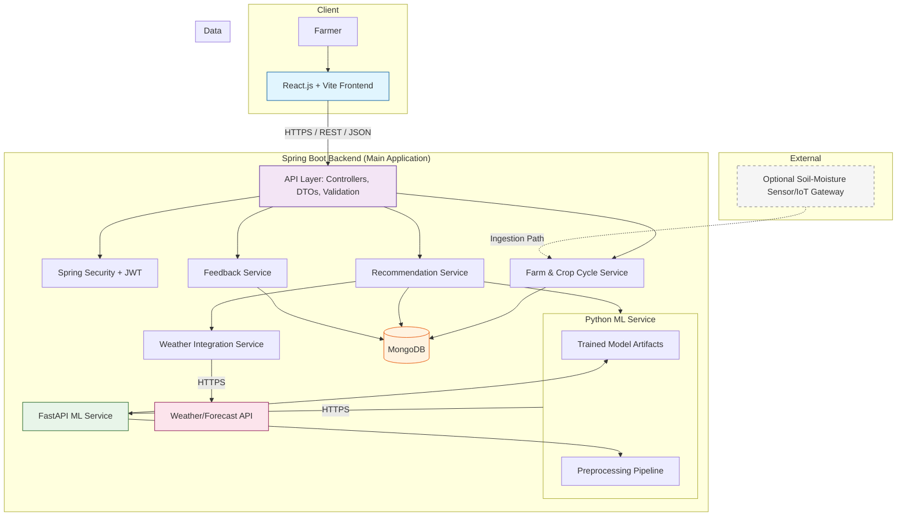
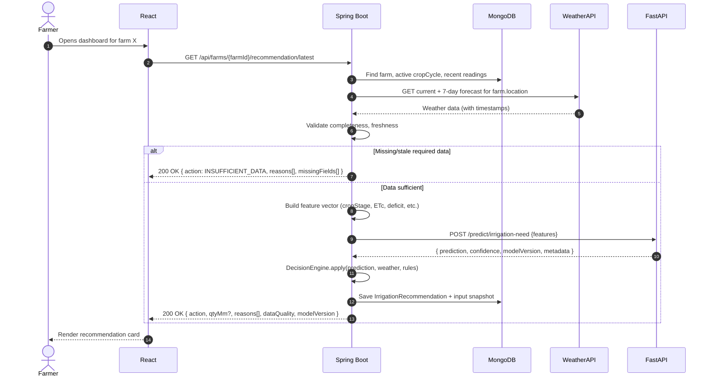
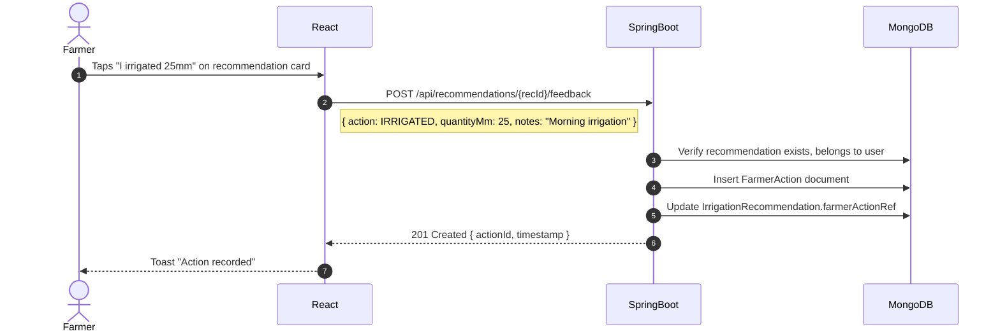
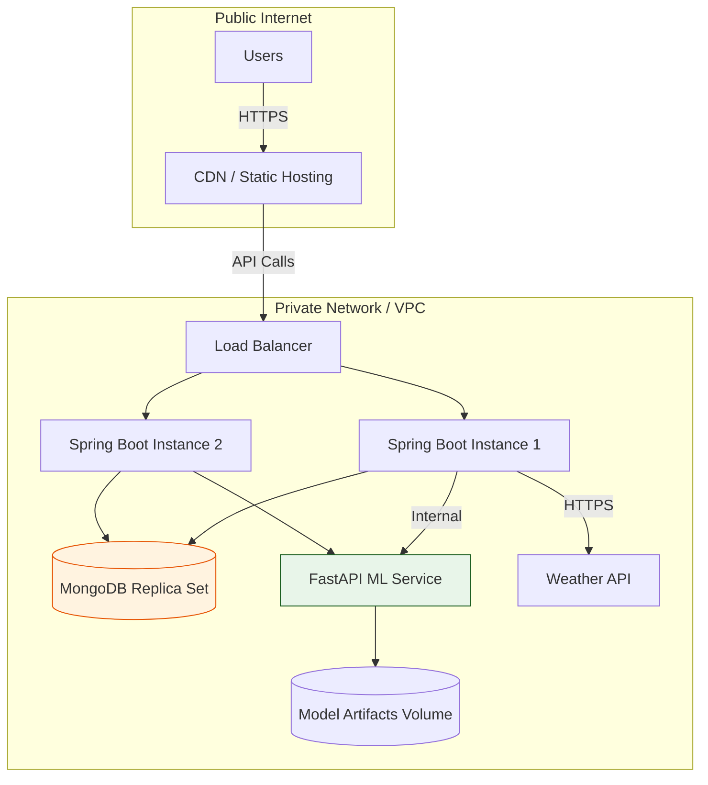

# JALRAKSHAK — Architecture Document (Phase 1)

**Version:** 1.0  
**Date:** 2026-10-20  
**Phase:** 1 — Requirements and Architecture  

---

## 1. High-Level Architecture



---

## 2. Service Specifications

### 2.1 React Frontend (Client)

| Aspect | Detail |
|--------|--------|
| **Framework** | React 18+ with JavaScript (ES2022) |
| **Build Tool** | Vite 5+ |
| **Routing** | React Router v6 |
| **State Management** | React Context + useReducer (or Zustand if needed) |
| **API Client** | Axios with interceptors for auth/error handling |
| **Charts** | Recharts 2+ |
| **Styling** | CSS3 + CSS Modules (or Tailwind if approved) |
| **Internationalization** | react-i18next (English default, regional TBD) |
| **PWA** | Service worker for offline caching (future) |
| **Deploy Target** | Static files (Netlify, Vercel, or nginx) |

**Key Components:**
- `AuthProvider` — JWT storage, refresh, logout
- `FarmSetupWizard` — Multi-step farm/crop profile creation
- `Dashboard` — Current recommendation card, weather summary, soil moisture
- `RecommendationDetail` — Explanation, reasons, data quality, confidence
- `History` — Paginated list of past recommendations + farmer actions
- `Settings` — Profile, language, notification preferences

### 2.2 Spring Boot Backend (Main Application)

| Aspect | Detail |
|--------|--------|
| **Framework** | Spring Boot 3.2+ (Java 21 LTS) |
| **API Style** | REST, JSON, OpenAPI 3.0 spec |
| **Database** | MongoDB via Spring Data MongoDB |
| **Security** | Spring Security 6 + JWT (access + refresh tokens) |
| **Validation** | Jakarta Bean Validation (Hibernate Validator) |
| **Documentation** | SpringDoc OpenAPI (Swagger UI at `/swagger-ui.html`) |
| **Configuration** | Spring Config Server / `@ConfigurationProperties` / YAML |
| **Logging** | SLF4J + Logback (structured JSON for production) |
| **Testing** | JUnit 5, Mockito, Testcontainers (MongoDB), Spring MVC Test |
| **Build** | Maven or Gradle (Kotlin DSL) |

**Module Structure:**
```
jalrakshak-backend/
├── jalrakshak-api           # Controllers, DTOs, OpenAPI config
├── jalrakshak-core          # Domain services, decision engine, validation
├── jalrakshak-data          # MongoDB repositories, documents, migrations
├── jalrakshak-security      # JWT, UserDetails, method security
├── jalrakshak-weather       # Weather provider abstraction + implementations
├── jalrakshak-ml            # FastAPI client, feature building, model versioning
└── jalrakshak-app           # SpringApplication, composition root
```

**Core Services:**
- `FarmService` — CRUD for farms, validation, ownership
- `CropCycleService` — Crop cycles, growth stage calculation (GDD)
- `WeatherService` — Provider abstraction, caching, freshness, normalization
- `MlClientService` — FastAPI communication, timeout/retry, circuit breaker
- `RecommendationService` — Orchestrates weather + ML + decision rules
- `DecisionEngine` — Pure logic: prediction + rules → recommendation
- `FeedbackService` — Farmer actions, outcome recording

### 2.3 MongoDB (Primary Database)

| Aspect | Detail |
|--------|--------|
| **Version** | MongoDB 7.0+ |
| **Driver** | Spring Data MongoDB 4+ (Reactive or Blocking) |
| **Collections** | users, farms, crop_cycles, weather_observations, soil_moisture_readings, irrigation_recommendations, farmer_actions, model_metadata |
| **Indexes** | Compound indexes on (userId, createdAt), (farmId, timestamp), (cropCycleId), geospatial on location |
| **Schema Validation** | JSON Schema validator per collection |
| **Migration** | Mongock or custom migration scripts |
| **Backup** | Point-in-time recovery, scheduled dumps |

### 2.4 FastAPI ML Service

| Aspect | Detail |
|--------|--------|
| **Framework** | FastAPI 0.110+ (Python 3.11+) |
| **ML Libraries** | scikit-learn 1.3+, XGBoost 2.0+, pandas 2.1+, numpy 1.26+ |
| **Model Serving** | Joblib/pickle artifacts loaded at startup |
| **Preprocessing** | Identical pipeline to training (sklearn Pipeline or custom) |
| **API** | `/health`, `/predict/irrigation-need` (POST) |
| **Validation** | Pydantic v2 models for request/response |
| **Observability** | Structured logging, `/metrics` (Prometheus), request tracing |
| **Container** | Docker (optional for MVP) |
| **Testing** | pytest, httpx, model validation scripts |

**Deployment:** Separate process/container. Spring Boot calls via HTTP. Not exposed to public internet.

### 2.5 Weather Integration

| Aspect | Detail |
|--------|--------|
| **Provider** | TBD (OpenWeatherMap, WeatherAPI, IMD, Tomorrow.io, etc.) |
| **Abstraction** | `WeatherProvider` interface in Spring Boot |
| **Data Needed** | Current: temp, humidity, wind, solar radiation, precipitation. Forecast: 7-day daily precip, temp min/max, humidity. |
| **Units** | SI (metric): °C, m/s, W/m², mm, % |
| **Caching** | Redis or in-memory (Caffeine) with TTL = 30 min |
| **Freshness** | Max age 6 hours for recommendation use |
| **Fallback** | Stale cached data + warning; if none → INSUFFICIENT_DATA |
| **Rate Limits** | Respect provider limits; queue/batch if needed |

---

## 3. Data Flow Details

### 3.1 Recommendation Request Flow



### 3.2 Farmer Feedback Flow



---

## 4. Security Architecture

### 4.1 Authentication & Authorization

```mermaid
flowchart LR
    subgraph Client
        R[React] -->|1. POST /auth/login| S[Spring Boot]
    end
    
    subgraph SpringBoot
        S -->|2. Validate credentials| UDB[(MongoDB: users)]
        S -->|3. Generate JWT pair| JWT[Access Token (15m) + Refresh Token (30d)]
        S -->|4. Store refresh token hash| RDB[(MongoDB: refresh_tokens)]
    end
    
    JWT --> R
    R -->|5. Authorization: Bearer <access>| API[Protected Endpoints]
    API -->|6. Validate JWT| SEC[Spring Security Filter]
    SEC -->|7. Check ownership| MONGO
```

**Token Design:**
- **Access Token:** JWT, 15 min expiry, claims: `sub` (userId), `roles`, `farmIds[]` (optional)
- **Refresh Token:** Opaque random string, 30 days, stored hashed in MongoDB, rotated on use
- **Logout:** Revoke refresh token; access token expires naturally

### 4.2 Authorization Rules

| Endpoint Pattern | Required Role | Ownership Check |
|------------------|---------------|-----------------|
| `POST /api/auth/*` | Anonymous | — |
| `GET /api/farms` | `FARMER` | Returns user's farms |
| `POST /api/farms` | `FARMER` | Sets owner = current user |
| `GET /api/farms/{id}` | `FARMER` | Farm.ownerId == userId |
| `POST /api/crop-cycles` | `FARMER` | Farm owned by user |
| `GET /api/farms/{id}/recommendations*` | `FARMER` | Farm owned by user |
| `POST /api/recommendations/{id}/feedback` | `FARMER` | Recommendation.farmId owned by user |

---

## 5. Error Handling Strategy

| Layer | Approach |
|-------|----------|
| **React** | Axios interceptor → global error boundary → user-friendly toast/snackbar; retry for 5xx |
| **Spring Boot** | `@ControllerAdvice` → RFC 7807 ProblemDetail responses; validation errors → 400 with field details |
| **FastAPI** | Pydantic validation → 422; custom exceptions → 400/500 with error codes |
| **MongoDB** | Duplicate key → 409; not found → 404; timeout → 503 |
| **Weather API** | Timeout 5s, retry 2x with backoff; circuit breaker after 5 failures |
| **ML Service** | Timeout 10s; if unavailable → INSUFFICIENT_DATA with reason `ML_SERVICE_UNAVAILABLE` |

**Error Response Format (Spring Boot):**
```json
{
  "type": "https://api.jalrakshak.org/errors/validation-failed",
  "title": "Validation Failed",
  "status": 400,
  "detail": "One or more fields are invalid",
  "instance": "/api/farms",
  "errors": [
    { "field": "areaHa", "message": "Must be greater than 0" }
  ]
}
```

---

## 6. Observability

| Concern | Implementation |
|---------|----------------|
| **Logging** | Structured JSON (Logstash encoder); correlation ID via MDC/Context |
| **Metrics** | Micrometer + Prometheus (Spring Boot); Prometheus client (FastAPI) |
| **Tracing** | Micrometer Tracing + OpenTelemetry (future); correlation IDs passed via headers |
| **Health Checks** | Spring Boot Actuator `/actuator/health` (liveness/readiness); FastAPI `/health` |
| **Alerting** | TBD (Prometheus Alertmanager + Grafana) |

---

## 7. Configuration Management

| Config | Location | Examples |
|--------|----------|----------|
| **Spring Boot** | `application.yml` + env overrides | `spring.data.mongodb.uri`, `jwt.secret`, `weather.api.key`, `ml.service.url` |
| **FastAPI** | Pydantic Settings (`.env`) | `MODEL_PATH`, `PREPROCESSOR_PATH`, `LOG_LEVEL` |
| **React** | `.env` (Vite) | `VITE_API_BASE_URL` |
| **Secrets** | **Never in code** — Environment variables / Kubernetes secrets / Docker secrets |

---

## 8. Deployment Topology (Target)



> **MVP Note:** Single-instance deployment acceptable. Docker Compose for local dev. Kubernetes manifests for production (future).

---

## 9. Technology Version Lock

| Component | Version | Source |
|-----------|---------|--------|
| Java | 21 LTS | Locked |
| Spring Boot | 3.2.x | Locked |
| MongoDB | 7.0+ | Locked |
| Spring Data MongoDB | 4.1+ | Locked |
| React | 18.2+ | Locked |
| Vite | 5.0+ | Locked |
| React Router | 6.20+ | Locked |
| Recharts | 2.10+ | Locked |
| Python | 3.11+ | Locked |
| FastAPI | 0.110+ | Locked |
| scikit-learn | 1.3+ | Locked |
| XGBoost | 2.0+ | Locked |
| pandas | 2.1+ | Locked |
| numpy | 1.26+ | Locked |

---

## 10. Architectural Decision Records (ADRs)

| ADR | Title | Status |
|-----|-------|--------|
| ADR-001 | MongoDB as primary database | **Accepted** (locked) |
| ADR-002 | Spring Boot owns orchestration; FastAPI serves ML only | **Accepted** (locked) |
| ADR-003 | JWT with short access + rotating refresh tokens | **Accepted** |
| ADR-004 | Decision engine separate from ML prediction | **Accepted** |
| ADR-005 | `INSUFFICIENT_DATA` as explicit recommendation status | **Accepted** |
| ADR-006 | Weather provider behind interface for swapability | **Accepted** |
| ADR-007 | Crop/region configuration externalized, not hardcoded | **Accepted** |
| ADR-008 | Farmer action recording for monitoring/learning | **Accepted** |

---

## 11. Risks and Mitigations

| Risk | Likelihood | Impact | Mitigation |
|------|------------|--------|------------|
| No representative ML training data | High | High | Phase 4: rules-based prototype; collect field data |
| Weather API unavailable/expensive | Medium | High | Provider abstraction; caching; fallback to INSUFFICIENT_DATA |
| Crop/region thresholds undefined | High | High | Phase 5: agronomic expert review before pilot |
| Farmer trust/adoption low | Medium | High | Explainable recommendations; simple UI; pilot feedback |
| Data quality (sensor/manual) | High | Medium | Validation ranges; freshness checks; explicit warnings |
| Spring Boot ↔ FastAPI contract drift | Medium | Medium | Shared OpenAPI spec; contract tests; versioned endpoints |
| MongoDB schema evolution | Low | Medium | JSON Schema validation; Mongock migrations |