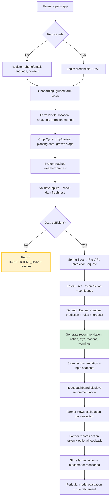
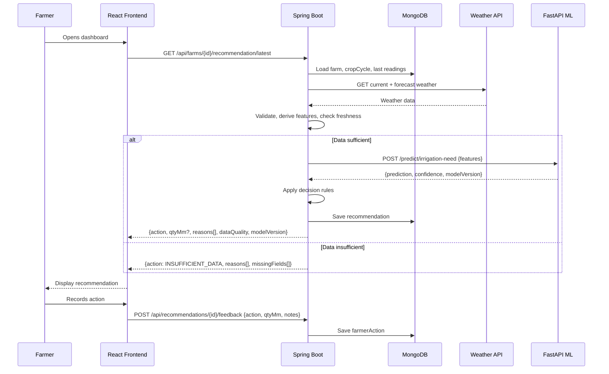

# JALRAKSHAK — Requirements Document (Phase 1)

**Version:** 1.0  
**Date:** 2026-10-20  
**Phase:** 1 — Requirements and Architecture  
**Status:** Draft — Pending owner confirmation on crop/region

---

## 1. Project Scope

JALRAKSHAK is an AI-assisted Smart Irrigation Decision Support System within the KRISHISETU concept. It helps farmers make informed irrigation decisions based on farm, crop, soil, weather, and available soil-moisture information.

**Core principle:** The farmer retains control over irrigation decisions. The system provides recommendations with explanations, not automated control.

---

## 2. First Supported Crop and Geographic Region

> **⚠️ PENDING OWNER DECISION**

| Decision | Value | Status |
|----------|-------|--------|
| First crop | *Not yet selected* | **Pending** |
| Geographic region | *Not yet selected* | **Pending** |
| Language support | English (default), regional language TBD | **Pending** |

**Action required:** Owner must confirm the first crop (e.g., wheat, rice, cotton, sugarcane) and target region (state/district in India) before Phase 2 begins. This affects:
- Crop-specific agronomic rules and water requirements
- Weather API provider coverage and forecast granularity
- Soil type classifications relevant to the region
- Regulatory/compliance considerations
- Pilot farmer recruitment

**Assumption for architecture:** The system is designed to be crop- and region-agnostic at the data-model level. Crop/region specifics live in configuration and rule engines, not hardcoded schemas.

---

## 3. Farmer Journey

### 3.1 Journey Overview (Mermaid)



### 3.2 Journey Steps Detail

| Step | Screen/Action | Key Data Collected | Validation |
|------|---------------|-------------------|------------|
| 1. Register | Phone/email, password, language, consent | User identity, auth credentials | Unique phone/email, strong password, consent recorded |
| 2. Login | Credentials → JWT token | Auth token | JWT expiry, refresh token rotation |
| 3. Farm Setup | Location (lat/lng + address), area (ha), soil type, irrigation method | Farm profile | GPS bounds, area > 0, soil from enum, method from enum |
| 4. Crop Cycle | Crop, variety, planting date, expected harvest | Crop cycle record | Valid crop for region, planting date ≤ today |
| 5. Weather Fetch | Auto: current + 7-day forecast | Weather observations | Timestamp freshness < 6h, source reliability |
| 6. Soil Moisture (optional) | Manual entry or sensor reading | Soil moisture reading | 0–100% volumetric, timestamp < 24h |
| 7. Recommendation | Display action, qty (if supported), reasons, confidence | Irrigation recommendation | Must include: action, reasons[], dataFreshness, modelVersion |
| 8. Farmer Action | Record: IRRIGATED / WAITED / PARTIAL + qty applied + notes | Farmer action record | Action from enum, qty ≥ 0 if provided |
| 9. Feedback Loop | Optional: outcome rating, yield note | Feedback for monitoring | 1–5 rating, free text ≤ 500 chars |

---

## 4. Required and Optional Farm Inputs

### 4.1 Required Inputs (Must be present for any recommendation)

| Field | Type | Unit/Format | Validation | Source |
|-------|------|-------------|------------|--------|
| `farmId` | UUID | — | Exists, owned by user | Farm profile |
| `cropCycleId` | UUID | — | Exists, active, linked to farm | Crop cycle |
| `location` | GeoJSON Point | [lng, lat] | Valid coordinates, within service region | Farm profile |
| `areaHa` | Decimal | Hectares | > 0, ≤ 1000 (configurable max) | Farm profile |
| `soilType` | Enum | `SANDY`, `LOAMY`, `CLAY`, `SILTY`, `PEATY`, `CHALKY` | From controlled vocabulary | Farm profile |
| `irrigationMethod` | Enum | `FLOOD`, `SPRINKLER`, `DRIP`, `FURROW`, `CENTER_PIVOT` | From controlled vocabulary | Farm profile |
| `crop` | String | — | From supported crops list | Crop cycle |
| `variety` | String | — | From supported varieties for crop | Crop cycle |
| `plantingDate` | ISO 8601 Date | YYYY-MM-DD | ≤ today, ≥ 2 years ago | Crop cycle |
| `currentWeather` | Object | See Weather schema | Freshness < 6 hours | Weather API |
| `forecast` | Array[Object] | 7-day forecast | Freshness < 6 hours, ≥ 3 days | Weather API |

### 4.2 Optional Inputs (Enhance recommendation quality)

| Field | Type | Unit/Format | Validation | Source |
|-------|------|-------------|------------|--------|
| `soilMoisturePct` | Decimal | % volumetric (0–100) | 0–100, timestamp < 24h | Sensor or manual entry |
| `soilMoistureDepthCm` | Integer | cm | 10–200 | Sensor config |
| `lastIrrigationDate` | ISO 8601 DateTime | YYYY-MM-DDTHH:mm:ssZ | ≤ now | Farmer action history |
| `lastIrrigationQtyMm` | Decimal | mm | ≥ 0 | Farmer action history |
| `cropStageOverride` | Enum | `GERMINATION`, `VEGETATIVE`, `FLOWERING`, `GRAIN_FILL`, `MATURITY` | If auto-detection unreliable | Agronomist/farmer |
| `fieldCapacityPct` | Decimal | % volumetric | 0–100, > wiltingPoint | Soil lab or lookup |
| `wiltingPointPct` | Decimal | % volumetric | 0–100, < fieldCapacity | Soil lab or lookup |
| `soilEcDsM` | Decimal | dS/m | ≥ 0 | Soil test |
| `soilPh` | Decimal | pH units | 3.0–10.0 | Soil test |

### 4.3 Derived Fields (Computed by backend)

| Field | Derived From | Purpose |
|-------|--------------|---------|
| `cropStage` | plantingDate + crop-specific GDD model | Growth stage for water demand |
| `daysSincePlanting` | plantingDate → today | Crop age |
| `effectiveRainfallMm` | forecast + currentWeather | Net water input |
| `et0Mm` | weather (temp, humidity, wind, solar) | Reference evapotranspiration |
| `kc` | crop + cropStage | Crop coefficient |
| `etcMm` | et0Mm × kc | Crop evapotranspiration |
| `availableWaterMm` | soilMoisturePct × depth × soil properties | Plant-available water |
| `deficitMm` | etcMm - effectiveRainfallMm - availableWaterMm | Irrigation need estimate |

---

## 5. Recommendation Statuses

| Status | Code | Meaning | When Returned | Water Quantity Shown? |
|--------|------|---------|---------------|----------------------|
| **IRRIGATE** | `IRRIGATE` | Full irrigation recommended | Deficit > threshold AND no rain forecast AND data sufficient | **Yes** (if supported by logic) |
| **WAIT** | `WAIT` | Do not irrigate now | Deficit ≤ threshold OR significant rain forecast OR high soil moisture | **No** |
| **PARTIAL_IRRIGATION** | `PARTIAL_IRRIGATION` | Reduced irrigation recommended | Moderate deficit + some rain forecast OR partial soil moisture | **Yes** (reduced qty) |
| **INSUFFICIENT_DATA** | `INSUFFICIENT_DATA` | Cannot make reliable recommendation | Missing required inputs, stale data, out-of-range values, model unavailable | **Never** |

### 5.1 Decision Logic (High-Level)

```
IF any required input missing OR stale (> freshness threshold)
   → INSUFFICIENT_DATA (with specific missing/stale fields listed)

ELSE
   deficitMm = calculateDeficit(inputs)
   rainForecastMm = sum(forecast[0..2 days].precipitation)
   
   IF deficitMm > IRRIGATE_THRESHOLD AND rainForecastMm < RAIN_THRESHOLD
      → IRRIGATE
   ELSE IF deficitMm <= WAIT_THRESHOLD OR rainForecastMm >= RAIN_THRESHOLD
      → WAIT
   ELSE
      → PARTIAL_IRRIGATION
```

> **Thresholds are crop- and region-specific.** Values TBD in Phase 5 with agronomic review.

---

## 6. Validation Rules

### 6.1 Input Validation (Spring Boot)

| Category | Rules |
|----------|-------|
| **Identity** | JWT valid, not expired, user owns farm/cropCycle |
| **Geometry** | Location within service boundary polygon; areaHa > 0 |
| **Enums** | soilType, irrigationMethod, crop, variety from configured lists |
| **Dates** | plantingDate ≤ today; forecast dates ≥ today |
| **Ranges** | soilMoisturePct 0–100; areaHa ≤ max; pH 3–10; EC ≥ 0 |
| **Freshness** | Weather < 6h; soil moisture < 24h; forecast < 6h |
| **Consistency** | fieldCapacity > wiltingPoint; variety matches crop |
| **Completeness** | All required fields present for recommendation request |

### 6.2 Data Freshness Requirements

| Data Type | Max Age | Action If Stale |
|-----------|---------|-----------------|
| Current weather | 6 hours | Mark stale; use fallback or INSUFFICIENT_DATA |
| Forecast | 6 hours | Mark stale; reduce confidence |
| Soil moisture (sensor) | 24 hours | Mark stale; treat as unavailable |
| Soil moisture (manual) | 48 hours | Mark stale; treat as unavailable |
| Model prediction | N/A (real-time) | Timeout 5s → INSUFFICIENT_DATA |
| Crop stage (auto) | Recalculate daily | Always current |

### 6.3 Uncertainty Handling

| Source | Handling |
|--------|----------|
| Weather forecast uncertainty | Use ensemble mean; flag high variance (>30% CV) |
| Model prediction confidence | Return confidence score; if < 0.6, downgrade to PARTIAL or INSUFFICIENT |
| Missing optional inputs | Proceed with defaults; note in reasons |
| Sensor failure | Fall back to manual entry or weather-based estimate |
| ML service timeout/unavailable | Return INSUFFICIENT_DATA with reason `ML_SERVICE_UNAVAILABLE` |

### 6.4 Safe Fallback Behavior

1. **Never invent water quantities.** If calculation lacks validated agronomic basis → `INSUFFICIENT_DATA`.
2. **Conservative bias:** When uncertain, prefer `WAIT` or `PARTIAL_IRRIGATION` over `IRRIGATE`.
3. **Explicit reasons:** Every recommendation includes `reasons[]` array with human-readable explanations.
4. **Data quality flags:** Response includes `dataQuality: { weatherFresh: bool, soilFresh: bool, modelConfidence: number, warnings: string[] }`.
5. **Farmer override:** Farmer can always choose different action; system records deviation for learning.

---

## 7. Service Boundaries

### 7.1 Service Responsibility Matrix

| Service | Technology | Owns | Exposes | Calls |
|---------|------------|------|---------|-------|
| **React Frontend** | React.js + Vite | UI, farmer interaction, state | HTTPS pages + JS | Spring Boot REST API |
| **Spring Boot Backend** | Java + Spring Boot | Auth, validation, orchestration, persistence, decision engine | REST API (JSON) | MongoDB, Weather API, FastAPI |
| **MongoDB** | MongoDB | Data persistence | — | — |
| **FastAPI ML Service** | Python + FastAPI | Model inference, preprocessing | REST API (JSON) | Trained model artifacts |
| **Weather Provider** | External API | Weather/forecast data | REST API (JSON) | — |

### 7.2 Communication Flow



### 7.3 Data Ownership

| Entity | Owner Service | Other Services Access |
|--------|---------------|----------------------|
| `User` | Spring Boot | — |
| `Farm` | Spring Boot | React (read), FastAPI (read via Spring Boot) |
| `CropCycle` | Spring Boot | React (read), FastAPI (read via Spring Boot) |
| `WeatherObservation` | Spring Boot | React (read), FastAPI (read via Spring Boot) |
| `SoilMoistureReading` | Spring Boot | React (read), FastAPI (read via Spring Boot) |
| `IrrigationRecommendation` | Spring Boot | React (read) |
| `FarmerAction` | Spring Boot | React (read/write), FastAPI (read for eval) |
| `ModelMetadata` | FastAPI | Spring Boot (read) |

---

## 8. Assumptions and Pending Decisions

| ID | Assumption / Decision | Impact | Resolution Target |
|----|----------------------|--------|-------------------|
| A1 | First crop and region not yet selected | Affects crop lists, thresholds, weather provider | **Before Phase 2** |
| A2 | Weather API provider not selected | Affects integration contract, cost, data fields | Phase 3 |
| A3 | ML training dataset not identified | Affects feature set, model type, baseline | Phase 4 |
| A4 | Soil property defaults (FC, WP) by soil type | Affects water balance calculations | Phase 2 (config) |
| A5 | Irrigation threshold values (mm) | Core decision logic | Phase 5 (agronomic review) |
| A6 | Regional language(s) for UI | Affects i18n setup | Phase 6 |
| A7 | Sensor integration protocol | Affects data ingestion design | Future scope (optional) |
| A8 | Model retraining frequency | Affects MLOps design | Post-MVP |
| A9 | Multi-farm per user support | Affects data model, UI | Phase 2 |
| A10 | Offline-first capability for React | Affects architecture, caching | Future scope |

---

## 9. Out of Scope for MVP

- Automated irrigation control (hardware actuation)
- Satellite/remote sensing data
- Pest/disease risk module
- Market price integration (AGRIFAIR)
- Multi-language voice assistant
- Multi-region multi-crop from day one
- IoT sensor fleet management
- Advanced MLOps (A/B testing, automated retraining)
- Automated retraining